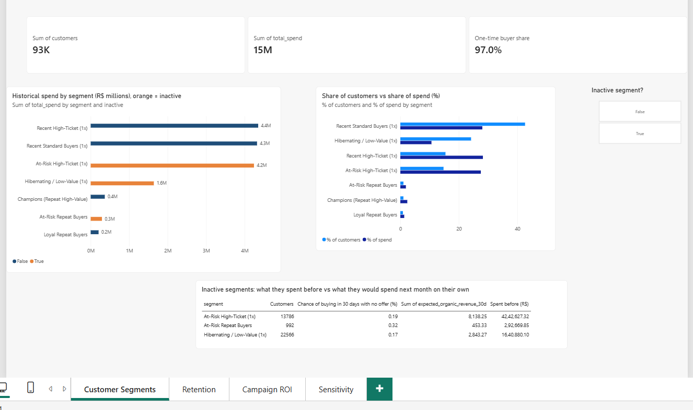
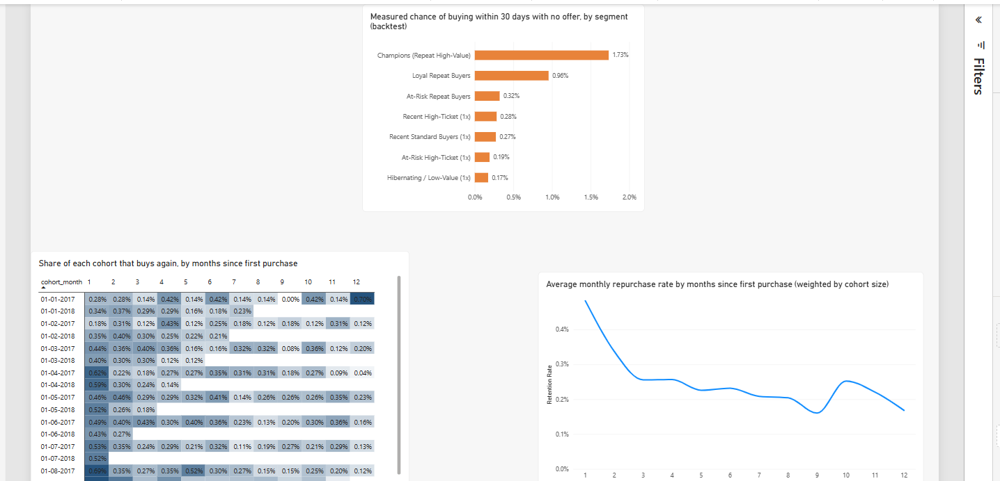
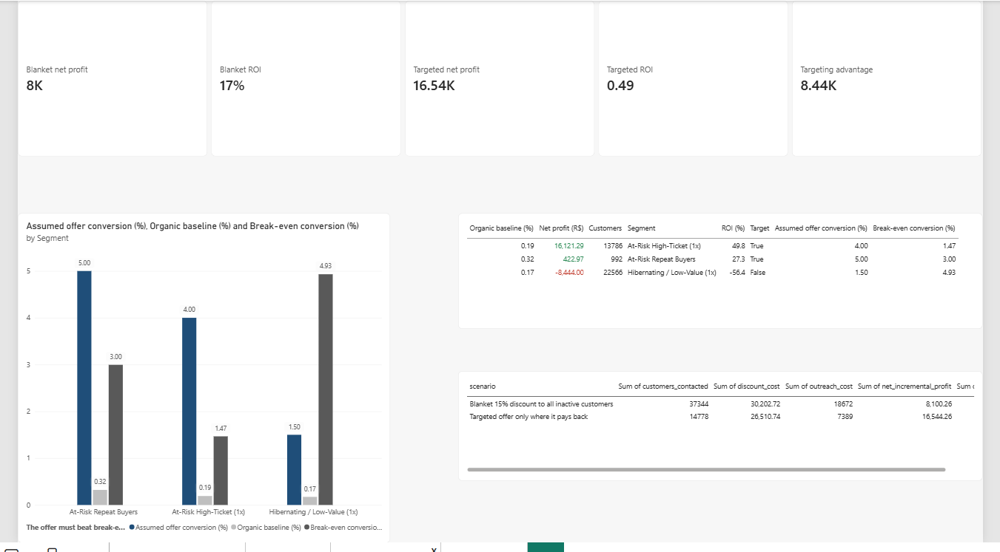
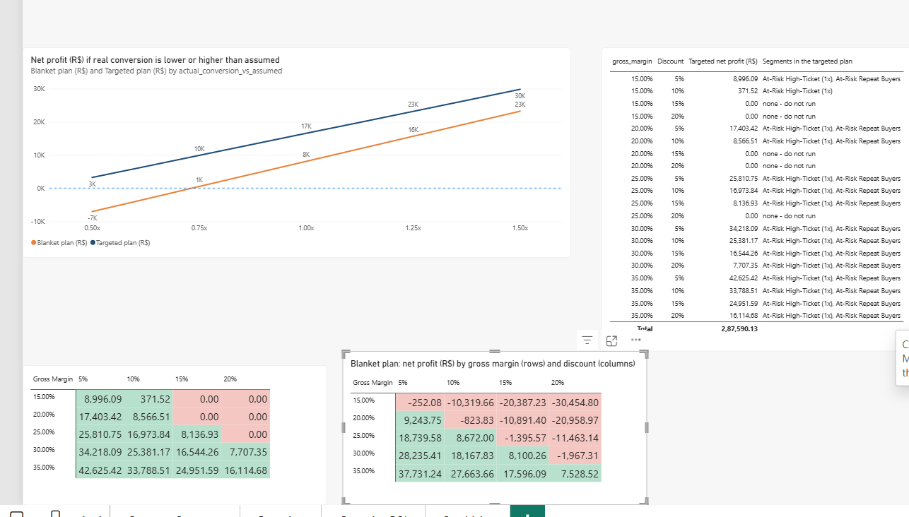
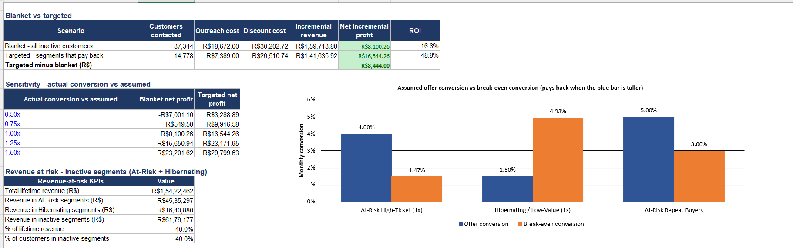

# Customer Retention, RFM Segmentation & Win-Back Campaign ROI

An end-to-end commercial analytics pipeline built on the **Brazilian E-Commerce Public Dataset by Olist** (**93,357 unique customers**, **96,477 delivered orders**, and **R$15.42M** in historical spend) using **SQL (SQLite)**, **Python**, **Power BI**, and **Excel**.

The core finding is a **break-even rule for win-back discounts**: a discount only pays back when a segment's average order value is high enough to cover the outreach cost and the discount at a plausible response rate. Under the planning assumptions listed below, targeting only the segments that clear break-even **more than doubles modeled net incremental profit (R$16,544.26 vs. R$8,100.26)**, nearly **triples campaign ROI (48.80% vs. 16.57%)** and cuts outreach spend by 60% (R$18,672 → R$7,389). These are modeled outcomes, not measured lift; the recommended A/B holdout test (see Next Steps) is what would measure it.

---

## Executive Summary & Business Impact

E-commerce retention teams frequently send blanket discount codes (e.g., 15% off) to all inactive customers. On Olist, the **least-recent 40% of customers (37,344 buyers, ~395 days since their last order on average)** hold **40.05% of historical spend (R$6.18M)**. Here "inactive" means the bottom two recency quintiles (`NTILE(5)`), so the 40% share comes from the definition rather than being a finding. Their order economics, however, vary dramatically. Modeled results use the planning assumptions in Section 3 below:

| Campaign Strategy | Segments Contacted | Customers | Outreach Cost | Discount Cost | Incremental Revenue | Net Incremental Profit | Campaign ROI |
| :--- | :--- | ---: | ---: | ---: | ---: | ---: | ---: |
| **Blanket 15% Discount** | All 3 Inactive Segments | 37,344 | R$18,672.00 | R$30,202.72 | R$159,713.88 | **R$8,100.26** | **16.57%** |
| **Targeted RFM Offer** | At-Risk High-Ticket (1x) + At-Risk Repeat | 14,778 | R$7,389.00 | R$26,510.74 | R$141,635.92 | **R$16,544.26** | **48.80%** |
| **Targeting Advantage** | Excludes Hibernating / Low-Value (1x) | **-22,566** | **-R$11,283.00** | **-R$3,691.98** | -R$18,077.96 | **+R$8,444.00** | **+32.23 pts** |

* **Why Blanket Discounting Fails:** Targeting the **22,566 `Hibernating / Low-Value (1x)`** customers (`R$72.71` AOV) loses **-R$8,444.00 (-56.39% ROI)**. That segment requires a **4.93% break-even conversion rate** against an assumed **1.50%** offer conversion.
* **Resilient Under Stress Testing:** If real-world conversion lands at **half (0.50x)** of planning assumptions, the blanket campaign loses **-R$7,001.10**, whereas the targeted campaign remains profitable at **+R$3,288.89**. The `At-Risk Repeat Buyers` segment itself drops below break-even at 0.50x (2.5% vs. 3.00% needed), so that result rests on the `At-Risk High-Ticket (1x)` segment.
* **Margin & Discount Guardrails:** A 20-cell sensitivity grid (`15%–35%` gross margin $\times$ `5%–20%` discount) identifies the exact 5 low-margin/high-discount combinations where no segment pays back (`R$0` / do not run).
* **Scale:** This models one win-back campaign measured over a 30-day window on a R$15.42M historical-spend base. The modeled net gain is ~R$16.5K, so the main value is the decision rule (which segments to skip), not the headline profit.

---

## Technical Architecture & Methodology

### 1. Relational Data Modeling & Multi-Table SQL (`rfm_segmentation.sql`, `cohort_retention.sql`)
* **Schema Joins:** Joined `olist_customers_dataset`, `olist_orders_dataset`, and `olist_order_payments_dataset` in SQLite.
* **Preventing the 1-to-Many Payment Fan-Out Trap:** Pre-aggregated `payments` by `order_id` in a CTE (`order_pay`) before joining to `orders` so split credit-card/voucher payments never duplicate order counts.
* **True Repeat-Customer Tracking:** Grouped by `customer_unique_id` (rather than order-level `customer_id`) across delivered orders (`order_status = 'delivered'`).
* **RFM Scoring:** Scored Recency and Monetary using `NTILE(5)` window functions and mapped Frequency using explicit business tiers (`1`, `2`, `3+` orders) because ~97% of Olist buyers (90,556 of 93,357) are one-time purchasers.
* **Inactivity Definition:** `Inactive` = `r_score <= 2` (bottom two recency quintiles). The pipeline asserts that this matches the three inactive segment labels and prints the equivalent day cutoff on every run.

### 2. Historical Backtest & Organic Baseline (`backtest_baseline.csv`)
* Rebuilt RFM segments across **14 rolling month-end snapshots (June 2017 – July 2018)** using only prior order history, then measured actual 30-day repurchase rates with no promotional offer.
* **Measured 30-Day Organic Baselines:** `Champions` (`1.73%`), `Loyal Repeat Buyers` (`0.96%`), `At-Risk Repeat Buyers` (`0.32%`), `At-Risk High-Ticket (1x)` (`0.19%`), and `Hibernating / Low-Value (1x)` (`0.17%`).
* `backtest_baseline.csv` is a committed, precomputed input to the pipeline and includes 95% Wilson confidence intervals; see the caveats under Limitations.

### 3. Segment-Level Campaign Economics (`campaign_economics.csv`)
Base planning assumptions: **30% gross margin before discount**, **15% win-back discount**, and **R$0.50 outreach cost per customer**.

| Inactive Segment | Customers | AOV (R$) | Organic 30d Baseline | Assumed Offer Conv. | Break-Even Conv. | Net Profit (R$) | ROI (%) | Decision |
| :--- | ---: | ---: | ---: | ---: | ---: | ---: | ---: | :---: |
| **At-Risk High-Ticket (1x)** | 13,786 | R$307.75 | 0.19% | 4.00% | 1.47% | **R$16,121.29** | **49.84%** | **Target** |
| **At-Risk Repeat Buyers** | 992 | R$141.80 | 0.32% | 5.00% | 3.00% | **R$422.97** | **27.27%** | **Target** |
| **Hibernating / Low-Value (1x)** | 22,566 | R$72.71 | 0.17% | 1.50% | 4.93% | **-R$8,444.00** | **-56.39%** | **Skip** |

---

## Deliverables & Visuals

### Power BI Dashboard (`rfm_churn_roi_dashboard.pbix`)
A 4-page executive report covering:
1. **Customer Segments:** KPI cards (`93,357` customers, `R$15.42M` spend), spend vs. customer share breakdown, and inactive segment risk table.
2. **Retention:** Monthly cohort retention heatmap (cohorts with 500+ customers, months 1–12), weighted average repurchase curve, and 14-snapshot backtest baseline chart.
3. **Campaign ROI:** Blanket vs. Targeted KPI comparison, segment-level break-even vs. assumed conversion bar chart, and scenario economics table.
4. **Sensitivity:** `0.50x–1.50x` conversion realization line chart and conditional-formatted Gross Margin $\times$ Discount heatmaps for both Blanket and Targeted plans.






### Interactive Excel ROI Calculator (`rfm_campaign_roi_calculator.xlsx`)
* **2-Sheet Workbook (`Calculator` & `Data`):** Allows marketing managers to adjust Discount %, Gross Margin %, Outreach Cost, and Assumed Offer Conversion rates in real time.
* **Reconciled to Python (`0.00` Variance):** Includes a dedicated reconciliation column verifying exact agreement with `campaign_economics.csv`, dynamic `SUMIF` / `SUMIFS` KPIs, a `0.50x–1.50x` sensitivity block, and an embedded break-even comparison chart.



---

## Repository Structure

```text
customer-rfm-churn-optimization/
├── rfm_segmentation.sql              # Multi-table SQLite query for RFM scoring & segmentation
├── cohort_retention.sql              # Monthly cohort retention query (month spine keeps 0% months)
├── rfm_churn_analysis.py             # End-to-end Python pipeline (segment summary, ROI, stress test & sensitivity)
├── rfm_campaign_roi_calculator.xlsx  # Interactive Excel What-If ROI & Break-Even Calculator
├── rfm_churn_roi_dashboard.pbix      # 4-page Power BI executive dashboard
├── segment_summary.csv               # 7-segment RFM summary (93,357 customers, R$15.42M)
├── inactive_segment_spend.csv        # Historical spend vs. expected 30d organic revenue
├── backtest_baseline.csv             # 14-snapshot organic 30-day repurchase rates (precomputed input)
├── campaign_economics.csv            # Segment-level win-back economics & break-even thresholds
├── campaign_comparison.csv           # Blanket vs. Targeted campaign roll-up
├── campaign_sensitivity.csv          # 0.50x to 1.50x conversion realization stress test
├── campaign_sensitivity_grid.csv     # 20-scenario Gross Margin x Discount sensitivity matrix
├── cohort_retention.csv              # Monthly cohort retention dataset
├── requirements.txt                  # Python dependencies
└── README.md                         # Project documentation
```

---

## Assumptions, Limitations & Next Steps
* **Measured vs. Assumed Inputs:** Organic 30-day repurchase baselines and historical AOVs (payment values including freight) are measured directly from Olist data. Gross margin (`30%`), discount (`15%`), outreach cost (`R$0.50`), and offer conversion rates (`4.0%`, `5.0%`, `1.5%`) are planning assumptions—documented transparently on the dashboard and stress-tested via the sensitivity grid.
* **Modeled, Not Measured:** The assumed offer conversions imply 8.7x–20.9x lifts over the organic baseline (`implied_lift_x` in `campaign_economics.csv`). The segment ranking follows from the break-even thresholds; the absolute profit is only as reliable as those conversion assumptions until a holdout test measures them.
* **Baseline Caveats:** Baselines are pooled across 14 snapshots, so the same customer can appear in several of them. The 95% intervals treat each customer-snapshot as independent and are therefore approximate; the `At-Risk Repeat Buyers` baseline rests on only 21 repurchases. Baselines were also measured on customers averaging ~250 days since their last order, versus ~395 days in the current inactive base.
* **Recommended Rollout:** Run a controlled **A/B holdout test** on a 10% sample of `At-Risk High-Ticket (1x)` and `At-Risk Repeat Buyers` to measure true incremental lift before full deployment.

## How to Reproduce
1. Download the [Brazilian E-Commerce Public Dataset by Olist](https://www.kaggle.com/datasets/olistbr/brazilian-ecommerce) from Kaggle and place `olist_customers_dataset.csv`, `olist_orders_dataset.csv`, and `olist_order_payments_dataset.csv` in the project root.
2. Install dependencies:
   ```bash
   pip install -r requirements.txt
   ```
3. Run `python rfm_churn_analysis.py`. It builds `olist_ecommerce.db` and regenerates `segment_summary.csv`, `cohort_retention.csv`, `campaign_economics.csv`, `campaign_comparison.csv`, `campaign_sensitivity.csv`, `campaign_sensitivity_grid.csv` and `inactive_segment_spend.csv` (plus the git-ignored `rfm_customers.csv`), and prints the recency cutoff behind "inactive". It reads the committed `backtest_baseline.csv` instead of recomputing the 14-snapshot backtest.